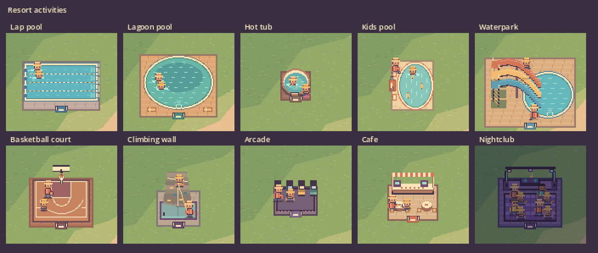
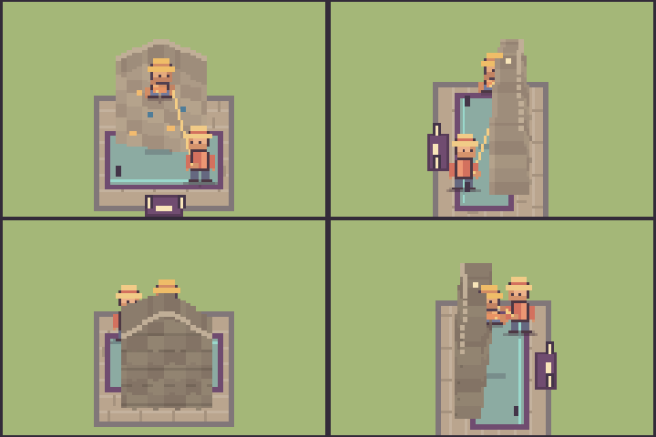

# All Inclusive

A compact resort-management game. Welcome families, set package prices, balance staff, and design the resort with buildings, furnishings, paths, terrain, and scenery.


## Play on Windows

[Download the latest Windows build](https://github.com/dgeller97/All-Inclusive/releases/latest/download/AllInclusive-Windows.zip), extract the ZIP, and double-click `AllInclusive.exe`. No Godot installation is required. [Release notes and checksums](https://github.com/dgeller97/All-Inclusive/releases/latest) are available on GitHub. Use the Windows ZIP asset, not GitHub's automatically generated source-code archives.

The current local Windows build is Revision 18: drifting sargassum now creates localized beach deposits, Developer controls select month and offshore intensity, and a hireable lifeguard sits on duty then swims out and brings distressed guests back. It retains swim buoys, separate interface drawing layers, guest/object depth corrections, Animation Viewer, fully furnished Developer showcase, 1280×960 map, connected and rotatable buildings, exterior customization, ocean swimming and nightly-price slider. The published GitHub release remains v0.3.0 until a new release is uploaded.

Extract `build/AllInclusive-Windows.zip` and open `AllInclusive.exe`. From the project folder, open `build/windows-r18/AllInclusive.exe` for the current build. Earlier version folders remain separate, and the running executable in `build/windows/` is untouched. The game runs on 64-bit Windows and includes its assets.

Open the resort to begin a three-day run. At 1×, the resort clock runs for 12 minutes before the Day 3 recap. Reach eight completed stays, earn a 75 average rating, and install the pool terrace. The recap lets you keep managing on Day 4 or start a fresh run.

- Use **Booking** to set the nightly price with the $90–$200 slider, in $5 steps. Bookings lock at 08:00 (20 elapsed simulation seconds); later changes apply to the following day. Higher prices raise expectations and reduce demand from four to three families at $150.
- Use **Staff** to assign the floating worker to reception, the buffet, or the pool.
- Use **Build** to draw bedrooms, reception, a buffet, and a pool. Place beds, desks, counters, dining tables, loungers, umbrellas, plants, and benches. Two accessible loungers and an umbrella give the pool its terrace bonus.
- Use **Reviews** and **Goals** to track guest ratings and Day 3 targets. Click another dock icon to switch panels. Close a panel with its X, by clicking outside it, or by pressing Esc.
- Space and the on-screen Pause button pause or resume. Keys 1, 2, and 3 resume at 1×, 2×, and 4×.
- Open **Settings** from the dock or with Esc when all panels are closed. Settings pauses the clock and contains Save, Load, sound, and Quit. Loading restores the saved run paused.
- Hold the left or middle mouse button and drag to explore. Scroll to zoom toward the cursor, use the on-screen zoom buttons, or press Home to return to the opening view.
- The beach flag shows **Calm** (green), **Caution** (yellow), or **Closed** (red) as the surf changes with the resort clock.

Windows stores the save and audio preference under `%APPDATA%\Godot\app_userdata\All Inclusive`.

## Design your resort

### Beach activities and entertainment

New games include a small starter leisure area. After their pool visit, families can relax at beach loungers or play volleyball, then stop for an included drink. Later in the day, guests can watch a performance at the outdoor stage. Venues use the furniture you actually place, with reachable access and limited capacity. Full or unreachable optional venues are skipped so families can still finish their holiday.

Open **Build → Facilities** to buy and place venues. The catalog shows their prices, or **Free** in Developer mode. Regular construction costs are $40 for a beach lounge, $100 for a volleyball court, $100 for a beach bar and $120 for a stage. Use **Select → Move** to relocate a facility, R to rotate while placing or moving, and **Bulldoze** to remove it. These tools work regardless of which construction category is open. Starter amenities can be removed but have no demolition refund; purchased amenities use the usual half-cost refund. You can place additional bars or activities around the resort.

The Facilities catalog has three groups:

- **Water:** Lap pool ($160), Lagoon pool ($180), Hot tub ($100), Kids pool ($120), Waterpark ($220).
- **Sport:** Volleyball ($100), Basketball court ($100), Climbing wall ($100).
- **Social:** Beach lounge ($40), Beach bar ($100), Stage ($120), Arcade ($90), Cafe ($60), Nightclub ($140).

Guests choose among connected daytime activities, visit a cafe or beach bar for refreshments, and can attend a stage show or nightclub at night. Each venue has its own activity animation and limited family slots. The additional pools are optional attractions; the main staffed pool remains part of the core hotel loop. These venues have fixed footprints and prefab interiors. Room buildings retain their separate floor, wall, ceiling, facade and roof settings. New attractions are added through construction and are not inserted into existing resorts automatically.

Each distinct activity a family completes adds one satisfaction point, capped at three per stay. Reviews show the activity bonus. Guest activities are included in the package, with no extra per-drink charge. Reservations and activity progress save with the run. Existing saves keep their layouts and can add the new venues through Build.

Open **Leisure** in the icon dock to see venue capacity and availability. Stage visits begin at **00:00 on the game clock**, three elapsed minutes into the resort day. Use Home to return to a view that includes the beach venues, then zoom in to watch the activities.

Guests can walk to the shore and swim in the ocean. Open **Beach** for swimming policy, surf conditions, cleaning and incident records. **Safe flags**, the default policy, brings swimmers back when conditions turn red. **Closed** stops ocean visits. **Allow red risk** deliberately permits dangerous swimming: a guest can drown, the surviving companion leaves, and a recorded incident gives a zero-score review. These are non-graphic events. The pool and dry beach activities remain available independently of the ocean flag. The shoreline itself stays fixed.

The world moves through dawn, daylight, dusk and night. The fictional Caribbean calendar begins in March, advances one month every three resort days, and shows seasonal temperature. Sargassum arrives more heavily in summer and builds up visibly along the beach; exposed guests give lower ratings. Beach cleaning removes up to 60 buildup for $30 in Regular mode or free in Developer mode. The [seasonal design notes](docs/seasonal-research.md) distinguish researched patterns from the game's compressed calendar and authored temperatures.

Floating sargassum patches appear in deep water and drift shoreward, with seasonal intensity, broad seeded sizes and changing weather fronts. Each arrival adds its own material at its landfall row. March–October normally brings arrivals, with heavier summer coverage; winter stops new arrivals while existing patches finish drifting. Cleaning affects shore deposits, not incoming patches, and some old material washes away at day end. The saved ledger preserves active patches and localized buildup; older saves migrate their existing buildup to local piles without resetting guests. This is an authored game model, not an environmental forecast. A shore-open buoy outline follows the actual swimming area year-round. It marks location, not guaranteed safety.

In **Developer mode → Beach → Developer tests**, choose **Month**, set **Offshore intensity** from 0–100, or select **Auto** for seasonal intensity. **Calendar auto** restores the natural calendar. These settings preserve operational day/time, guests and bookings; existing patches continue their trajectories. **Force offshore arrival** creates a real incoming patch. Resume time and explore the ocean to watch it land: travel takes roughly 72–108 simulation seconds, or 18–27 seconds at 4×. Controls and active arrivals save with the run.

In **Staff**, choose **Hire · Beach** or **Hire · Main pool**. One lifeguard costs **$60 upfront plus $25 daily payroll** in Regular mode; both costs are zero in Developer mode. The guard sits at a reachable post, swims out, tows a distressed guest back and returns to duty. Coverage applies only to the assigned beach or main staffed pool, not both sites or optional activity pools. A busy guard cannot switch assignment or handle a second rescue. Red-flag swimming can still be fatal. Rare main-pool cramps begin after Day 3; unguarded pool guests self-recover with feedback.

To inspect a rescue reliably, hire in Developer mode, then choose **Beach → Start rescue drill** and resume at 1×. It uses an eligible swimming guest or a clearly labelled training volunteer. Once the guard returns, assign the other site in Staff and repeat. A drill is blocked too near day end. Saving preserves assignment and an in-progress rescue, including the outbound swim, tow and return to duty.

Generated comparisons show [one patch reaching shore and depositing](docs/screenshots/sargassum-landfall.png), [varied offshore patches and local piles](docs/screenshots/sargassum-patches.png), and [lifeguard duty/rescue phases at both sites](docs/screenshots/lifeguard-rescue.png). These use production drawing commands and simulated states, not native gameplay captures. See [R18 validation](docs/revision-18-validation.md) for checks and limits.

The amenity choices draw on [official resort research](docs/resort-research.md), including beach sports, oceanside drinks and live entertainment.



This preview is generated from the game's drawing code and guest states; it is not a native gameplay capture.

### Restaurant visits

Families now collect food at the buffet counter, carry their plates to an available table, sit and eat, then leave for the pool. Each table serves one family at a time and is reserved while they walk over and eat. Guests use the actual tables placed in your restaurant, including tables you add or rebuild elsewhere.

Diners prefer reachable seats on opposite sides of the table. Keep both aisles open for the clearest seating arrangement; tight older layouts retain their fallback seating. Seated heads and bodies keep their native pixel proportions, with separate bent legs and chair poses. See the generated [before-and-after comparison](docs/screenshots/seated-before-after.png).

Assigning the floating worker to the buffet adds a food-collection slot; adding accessible dining tables reduces seating waits. With the current arrival spacing, tables are the main restaurant bottleneck and the extra buffet slot is rarely needed. Regular dining tables cost $20 each. Leave walking space beside them for diners. Long waits for a table can lower reviews separately from the buffet queue. Meal progress and table reservations save with the run.

Switch to **Show interiors** to watch guests collecting, carrying and eating their food. Exterior view hides diners inside enclosed buildings.

### Construction

Start a **Regular resort** to pay construction costs, or choose **Developer showcase** for a ready-to-run resort with every building type, furnishing, activity venue, and scenery type already placed. All 14 activities receive guest visits during the first three days; use 4× speed to watch the tour sooner. Everything remains editable through Build, with free construction and no refunds for the preplaced assets. Drag to explore the larger map, scroll to inspect guests, and press Home for the overview.

The showcase is installed only when starting a fresh Developer run. Loading an existing save preserves your layout, including assets you removed; it does not add the showcase to an old resort. Regular mode keeps its original starter progression and gains the expanded building space. A regular pool improvement costs $100 in furnishings (two $30 loungers and a $40 umbrella); starter hotel assets have no demolition refund. Newly purchased assets refund half their paid cost when removed.

[Developer showcase map preview](docs/screenshots/expanded-developer-map.png) (generated from the actual layout).

Build mode pauses the clock and edits a draft. Choose a building and drag a rectangle on the land; choose a furnishing and click inside its matching building. Press R to rotate a new placement or a selected existing building, furnishing or outdoor object. Building rotation also turns its doors and contents; invalid rotations are rejected without partial changes. Select and Bulldoze recognize objects from every category. Bulldoze prioritizes furniture inside a building; click empty floor to remove that room and its contents. Relocating buildings or indoor furniture still requires rebuilding them. Middle-button drag and the mouse wheel pan and zoom. Right click or Esc cancels the current tool.

Enclosed rooms that share an edge of at least two grid tiles form a connected building unit with internal doorways and a joined exterior. Selecting a member and rotating turns the whole unit. Individual room functions, beds, names and capacities remain; bulldozing a room keeps its neighbors. Corner contact alone does not join rooms, and pools remain independent.

Rooms need accessible beds, reception needs a desk, and the buffet needs a counter and dining table. Keep doorways open and buildings clear of the ocean. Apply an operational layout immediately when no families are staying, or queue it for tomorrow while guests finish their holiday. Save draft preserves unfinished work. Discard returns to the hotel and drops edits made since the last draft save; a saved draft remains available from Build. Queued construction reserves its cost, and canceling the queued plan returns the reserved amount.

### Building appearance

Use **Show exterior / Show interiors** to switch the whole resort between cutaway interiors and complete buildings with roofs, front walls and signs. The pool stays outdoors. Entering Build temporarily shows interiors for editing; leaving it restores your chosen view. Your view preference saves with the run.

In Build, use **Select**, click an empty part of a building's floor, then open **Building settings**. Enter a name of up to 24 characters and press **Set name** or Enter; names appear on physical building signs. Lobby and Restaurant are the default service-building names. Pools can also be named.

Enclosed buildings have separate interior and exterior choices:

- Floor: Original, Tile, Wood, or Stone — $12 per changed floor.
- Wall: Original, Plaster, Brick, or Timber — $10 per changed wall.
- Ceiling: Original, Plaster, Beams, or Panels — $8 per changed ceiling.
- Facade: Original, Plaster, Brick, or Timber — $16 per changed room exterior.
- Roof: Original, Terracotta, Slate, or Metal — $20 per changed room roof.

**Inspect ceiling** previews the ceiling; **Inspect exterior** previews the draft facade and roof before applying it. Exterior finishes apply across a connected unit, while interior finishes remain per room. Renaming is free. Regular mode charges only the final finish differences in the draft, and Developer mode is free. Finish changes have no demolition refund. Names and finishes use the same Apply now/tomorrow and Save draft controls as construction; older compatible saves receive original finishes and rotation automatically.

Generated previews show [building rotations and joined rooms](docs/screenshots/architecture-preview.png), [asset orientations](docs/screenshots/rotation-preview.png), and [stable dining/court surfaces and ocean interactions](docs/screenshots/interactions-preview.png).

### Landscape tools

Open **Build → Landscape**, then choose **Terrain**, **Paths**, or **Scenery**.

- **Terrain:** paint grass, sand, or dirt on dry land with 1 × 1, 3 × 3, or 5 × 5 tile brushes. Left-drag and release to commit a stroke. The coastline and ocean remain fixed, including partly wet shoreline tiles. **Restore** returns the original ground and path surface on dry land.
- **Paths:** draw stone paths or boardwalks. **Erase path** reveals the underlying ground. Guests prefer connected paths, while unpaved dry land remains walkable. Diagonal strokes fill connecting cells so thin paths remain usable.
- **Scenery:** place palms, shrubs, rocks, outdoor benches, and the beach flag. All starter scenery is editable. Select an object and use **Move** to relocate it, R to rotate it, or **Bulldoze** to remove it. Moving scenery preserves its identity and purchase value.

Ground beneath buildings cannot be painted until the building is removed. Terrain, path, and Restore strokes that cross protected shoreline or ocean cells are rejected as a whole. Apply still requires a usable hotel and connected guest routes. Ocean animation follows the original shoreline; water painting, land reclamation and bridges are deferred. Ocean swimming is available through the Beach policy controls.

Regular mode charges per changed tile: grass/sand/dirt $1, stone path $2, and boardwalk $3. Surface removal has no resale refund; returning a draft to its active state cancels its quoted expense. Outdoor scenery costs $3–$15, moving it is free, and demolition refunds half its actual paid cost. Developer mode remains free. Terrain, paths, scenery, incomplete drafts, and queued plans all save with the run.

Earlier compatible saves continue to load. A save containing genuine water or shoreline edits from the superseded experimental build is rejected with a specific message; the saved file and current run remain unchanged. The same protection applies to queued plans and saved drafts.

## Run from source

This repository includes the game source, original assets and their generators, tests, and design records. Local Godot binaries, import caches, exported builds, and development save files are excluded from Git. On a fresh clone, install Godot 4.7.2 and open `project.godot`; the editor imports the included assets automatically. The `.tools/` commands below refer to the original development workspace's locally installed runtime.

To export from a fresh clone, install the matching Godot export templates and clear the two custom template overrides in the Windows Desktop export preset (or provision the local template files at the paths shown there).

Open `project.godot` in Godot 4.7.2 and run the project, or use the bundled development runtime from the project folder.

```powershell
$godot = ".\.tools\godot\Godot_v4.7.2-stable_win64_console.exe"
& $godot --headless --path . --editor --import --quit
& $godot --headless --path . --script res://tests/simulation_test.gd
& $godot --headless --path . --script res://tests/camera_test.gd
& $godot --headless --path . --script res://tests/ui_layout_test.gd
& $godot --headless --path . --script res://tests/layout_model_test.gd
& $godot --headless --path . --script res://tests/building_identity_test.gd
& $godot --headless --path . --script res://tests/building_renderer_test.gd
& $godot --headless --path . --script res://tests/dining_contract_test.gd
& $godot --headless --path . --script res://tests/beach_contract_test.gd
& $godot --headless --path . --script res://tests/construction_consistency_test.gd
& $godot --headless --path . --script res://tests/facilities_scene_test.gd
& $godot --headless --path . --script res://tests/calendar_test.gd
& $godot --headless --path . --script res://tests/revision9_contract_test.gd
& $godot --headless --path . --script res://tests/activity_expansion_test.gd
& $godot --headless --path . --script res://tests/seated_proportions_test.gd
& $godot --headless --path . --script res://tests/actor_facing_test.gd
& $godot --headless --path . --script res://tests/developer_showcase_test.gd
& $godot --headless --path . --script res://tests/expanded_world_test.gd
& $godot --headless --path . --script res://tests/animation_viewer_fixture_test.gd
& $godot --headless --path . --script res://tests/depth_occlusion_test.gd
& $godot --headless --path . --script res://tests/furniture_depth_test.gd
& $godot --headless --path . --script res://tests/world_ui_layer_test.gd
& $godot --headless --path . --script res://tests/construction_transactions_test.gd
& $godot --headless --path . --script res://tests/landscape_model_test.gd
& $godot --headless --path . -- --smoke-test
& ".\.tools\godot\Godot_v4.7.2-stable_win64.exe" --path .
```

With the custom Windows templates in `.tools/godot/templates/`, export the game with the **Windows Desktop** preset.

```powershell
& $godot --headless --path . --export-release "Windows Desktop" build/windows/AllInclusive.exe
```

The design and production notes are in `docs/`.

## Inspect animations

Open **Animation viewer** from the welcome screen or **Settings**, or press **F8**. You can inspect animations without starting or replacing a resort. The active resort clock and any construction draft stay frozen until you close the viewer with **Esc**, **F8**, or its close button.

Choose among all 14 activity venues, dining, buffet collection, main-pool swimming, walking, ocean swimming and ocean evacuation. The four synchronized panels use the game's actual runtime rendering and show 0°, 90°, 180° and 270° placements for rotatable facilities. Ocean examples retain the real fixed coastline instead of inventing a rotated shore.

Use play/pause, the time slider, playback speed and 1/30-second frame stepping to inspect the motion. Choose Fit, 2× or 4× magnification, compare one family with full occupancy, and select guest appearances. When reporting a visual problem, include the clip, phase, rotation and displayed time so the same frame can be reproduced. The viewer shows current animations for review; it does not automatically correct awkward poses.

Revision 15 audits all 14 activity venues plus dining, buffet collection and the main pool across four rotations, approach/activity/departure and single/full occupancy. Ground surfaces, upright objects, guests and effects now share physical depth ordering. Front-side guests stay visible while rock faces, cabinets, counters, nets, roofs and other opaque parts cover the appropriate rear portions. Furniture textures and native seated proportions are preserved.



This generated comparison reconstructs the production draw commands at Activity 5.47 seconds: 0°/90° above, 180°/270° below. It is not a native gameplay capture. The [R15 validation record](docs/revision-15-validation.md) separates draw-order/opacity tests from rendered pixel inspection. Synchronized full-occupancy examples can still bunch at shared entrances, buffet service positions and some swimming/lounge positions; the depth correction does not add crowd avoidance or eliminate every spacing issue.

## Resort scope

The starter resort has four bedrooms and three service areas. You can build up to eight bedrooms and one reception, buffet, and main pool. Bookings remain capped at four families per day (three at $150 or more), limited by usable bedrooms. Families follow a repeating daily schedule with meals, swimming and optional activities. Pricing, staffing, beach conditions and safety decisions affect revenue and reviews. Plants and benches are decorative; multiple floors, multiple copies of core service buildings, and a larger progression system are deferred.

See `docs/revision-16-validation.md` for the world/interface regression and canvas-isolation checks, `docs/revision-15.md` for the depth/rotation audit, `docs/revision-14.md` for the Animation Viewer, `docs/revision-13.md` for the Developer showcase and expanded map, `docs/revision-10.md` for the activities, `docs/revision-9.md` for connected architecture, seasons and swimming, and the earlier revision records for construction, restaurant visits, appearance and landscape editing. Current validation uses headless checks and generated art previews; interactive desktop playtesting remains paused. The native Windows playthrough in `docs/native-playtest.md` covers the original first playable release only.
