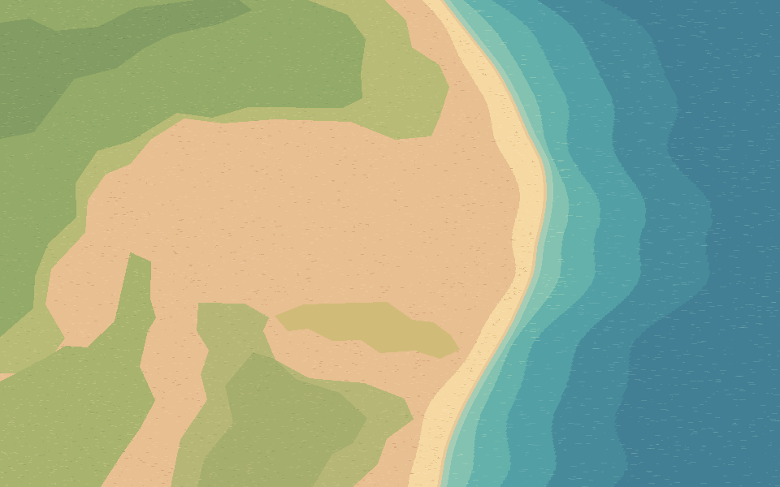
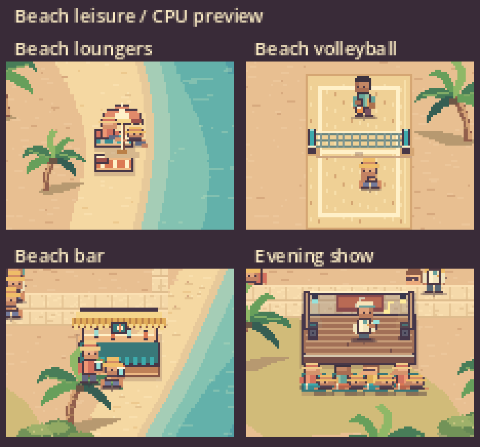

# All Inclusive

A compact resort-management game. Welcome families, set package prices, balance staff, and design the resort with buildings, furnishings, paths, terrain, and scenery.



## Play on Windows

[Download the latest Windows build](https://github.com/dgeller97/All-Inclusive/releases/latest/download/AllInclusive-Windows.zip), extract the ZIP, and double-click `AllInclusive.exe`. No Godot installation is required. [Release notes and checksums](https://github.com/dgeller97/All-Inclusive/releases/latest) are available on GitHub. Use the Windows ZIP asset, not GitHub's automatically generated source-code archives.

The current local development build is Revision 8, with a direct Facilities catalog and consistent selection/bulldozing across all construction categories, alongside usable beach amenities, restaurant interactions and landscape editing. The published GitHub release remains v0.3.0 until a new release is uploaded.

Extract `build/AllInclusive-Windows.zip` and open `AllInclusive.exe`. From the project folder, you can also open `build/windows/AllInclusive.exe` directly. The game runs on 64-bit Windows and includes its assets.

Open the resort to begin a three-day run. At 1×, the resort clock runs for 12 minutes before the Day 3 recap. Reach eight completed stays, earn a 75 average rating, and install the pool terrace. The recap lets you keep managing on Day 4 or start a fresh run.

- Use **Booking** to set the day’s package before 00:20. Later selections apply to the following day.
- Use **Staff** to assign the floating worker to reception, the buffet, or the pool.
- Use **Build** to draw bedrooms, reception, a buffet, and a pool. Place beds, desks, counters, dining tables, loungers, umbrellas, plants, and benches. Two accessible loungers and an umbrella give the pool its terrace bonus.
- Use **Reviews** and **Goals** to track guest ratings and Day 3 targets. Click another dock icon to switch panels. Close a panel with its X, by clicking outside it, or by pressing Esc.
- Space and the on-screen Pause button pause or resume. Keys 1, 2, and 3 resume at 1×, 2×, and 4×.
- Open **Settings** from the dock or with Esc when all panels are closed. Settings pauses the clock and contains Save, Load, sound, and Quit. Loading restores the saved run paused.
- Hold the left or middle mouse button and drag to explore. Scroll to zoom toward the cursor, use the on-screen zoom buttons, or press Home to return to the opening view.
- The beach flag shows **Calm** (green), **Caution** (yellow), or **Closed** (red) as the surf changes with the resort clock.

Windows stores the save and audio preference under `%APPDATA%\Godot\app_userdata\All Inclusive`.

## Design your resort

### Beach activities and entertainment

New games include a small starter leisure area. After their pool visit, families can relax at beach loungers or play volleyball, then stop for an included drink. Later in the day, guests can watch a performance at the outdoor stage. Venues use the furniture you actually place, with reachable access and limited capacity. Full or unreachable optional venues are skipped so families can still finish their holiday.

Open **Build → Facilities** to buy and place venues. The catalog shows their prices, or **Free** in Developer mode. Regular construction costs are $40 for a beach lounge, $100 for a volleyball court, $100 for a beach bar and $120 for a stage. Use **Select → Move** to relocate a facility, R to rotate while placing or moving, and **Bulldoze** to remove it. These tools work regardless of which construction category is open. Starter amenities can be removed but have no demolition refund; purchased amenities use the usual half-cost refund. You can place additional bars or activities around the resort.

Each distinct activity a family completes adds one satisfaction point, capped at three per stay. Reviews show the activity bonus. Guest activities are included in the package, with no extra per-drink charge. Reservations and activity progress save with the run. Existing saves keep their layouts and can add the new venues through Build.

Open **Leisure** in the icon dock to see venue capacity and availability. Stage visits begin at **03:00 on the simulation's four-minute day clock**. Use Home to return to a view that includes the beach venues, then zoom in to watch the activities.

The usable beach remains on dry land. The original coast and water remain fixed; red flags close the ocean, while dry beach activities remain available. Ocean swimming and water sports are not simulated in this revision.

The amenity choices draw on [official resort research](docs/resort-research.md), including beach sports, oceanside drinks and live entertainment.



This preview is generated from the game's drawing code and guest states; it is not a native gameplay capture.

### Restaurant visits

Families now collect food at the buffet counter, carry their plates to an available table, sit and eat, then leave for the pool. Each table serves one family at a time and is reserved while they walk over and eat. Guests use the actual tables placed in your restaurant, including tables you add or rebuild elsewhere.

Assigning the floating worker to the buffet adds a food-collection slot; adding accessible dining tables reduces seating waits. With the current arrival spacing, tables are the main restaurant bottleneck and the extra buffet slot is rarely needed. Regular dining tables cost $20 each. Leave walking space beside them for diners. Long waits for a table can lower reviews separately from the buffet queue. Meal progress and table reservations save with the run.

Switch to **Show interiors** to watch guests collecting, carrying and eating their food. Exterior view hides diners inside enclosed buildings.

### Construction

Start a **Regular resort** to pay construction costs, or choose **Developer · Free build** to experiment without spending money. The mode is saved with the run. A regular pool improvement costs $100 in furnishings (two $30 loungers and a $40 umbrella); starter hotel assets have no demolition refund. Newly purchased assets refund half their paid cost when removed.

Build mode pauses the clock and edits a draft. Choose a building and drag a rectangle on the land; choose a furnishing and click inside its matching building. Press R to rotate furnishings. Select and Bulldoze recognize buildings, furniture, facilities and scenery from every category. Bulldoze prioritizes furniture inside a building; click empty floor to remove a whole building and its contents. Moving buildings or indoor furniture currently requires bulldozing and rebuilding them. Middle-button drag and the mouse wheel still pan and zoom. Right click or Esc cancels the current tool.

Rooms need accessible beds, reception needs a desk, and the buffet needs a counter and dining table. Keep doorways open and buildings clear of the ocean. Apply an operational layout immediately when no families are staying, or queue it for tomorrow while guests finish their holiday. Save draft preserves unfinished work. Discard returns to the hotel and drops edits made since the last draft save; a saved draft remains available from Build. Queued construction reserves its cost, and canceling the queued plan returns the reserved amount.

### Building appearance

Use **Show exterior / Show interiors** to switch the whole resort between cutaway interiors and complete buildings with roofs, front walls and signs. The pool stays outdoors. Entering Build temporarily shows interiors for editing; leaving it restores your chosen view. Your view preference saves with the run.

In Build, use **Select**, click an empty part of a building's floor, then open **Building settings**. Enter a name of up to 24 characters and press **Set name** or Enter; names appear on physical building signs. Lobby and Restaurant are the default service-building names. Pools can also be named.

Enclosed buildings have separate **Floor**, **Wall**, and **Ceiling** choices:

- Floor: Original, Tile, Wood, or Stone — $12 per changed floor.
- Wall: Original, Plaster, Brick, or Timber — $10 per changed wall.
- Ceiling: Original, Plaster, Beams, or Panels — $8 per changed ceiling.

**Inspect ceiling** previews the selected building's ceiling separately from its exterior roof. Renaming is free. Regular mode charges only the final finish differences in the draft, and Developer mode is free. Finish changes have no demolition refund. Names and finishes use the same Apply now/tomorrow and Save draft controls as construction; older compatible saves receive the original finishes automatically.

### Landscape tools

Open **Build → Landscape**, then choose **Terrain**, **Paths**, or **Scenery**.

- **Terrain:** paint grass, sand, or dirt on dry land with 1 × 1, 3 × 3, or 5 × 5 tile brushes. Left-drag and release to commit a stroke. The coastline and ocean remain fixed, including partly wet shoreline tiles. **Restore** returns the original ground and path surface on dry land.
- **Paths:** draw stone paths or boardwalks. **Erase path** reveals the underlying ground. Guests prefer connected paths, while unpaved dry land remains walkable. Diagonal strokes fill connecting cells so thin paths remain usable.
- **Scenery:** place palms, shrubs, rocks, outdoor benches, and the beach flag. All starter scenery is editable. Select an object and use **Move** to relocate it, R to rotate it, or **Bulldoze** to remove it. Moving scenery preserves its identity and purchase value.

Ground beneath buildings cannot be painted until the building is removed. Terrain, path, and Restore strokes that cross protected shoreline or ocean cells are rejected as a whole. Apply still requires a usable hotel and connected guest routes. Ocean animation follows the original shoreline; water painting, land reclamation, bridges, and ocean swimming are deferred.

Regular mode charges per changed tile: grass/sand/dirt $1, stone path $2, and boardwalk $3. Surface removal has no resale refund; returning a draft to its active state cancels its quoted expense. Outdoor scenery costs $3–$15, moving it is free, and demolition refunds half its actual paid cost. Developer mode remains free. Terrain, paths, scenery, incomplete drafts, and queued plans all save with the run.

Earlier compatible saves continue to load. A save containing genuine water or shoreline edits from the superseded experimental build is rejected with a specific message; the saved file and current run remain unchanged. The same protection applies to queued plans and saved drafts.

## Run from source

This repository includes the game source, original assets and their generators, tests, and design records. Local Godot binaries, import caches, exported builds, and development save files are excluded from Git. On a fresh clone, install Godot 4.7.2 and open `project.godot`; the editor imports the included assets automatically. The `.tools/` commands below refer to the original development workspace's locally installed runtime.

To export from a fresh clone, install the matching Godot export templates and clear the two custom template overrides in the Windows Desktop export preset (or provision the local template files at the paths shown there).

Open `project.godot` in Godot 4.7.2 and run the project, or use the bundled development runtime from the project folder.

```powershell
$godot = ".\.tools\godot\Godot_v4.7.2-stable_win64_console.exe"
& $godot --headless --path . --editor --import --quit
& $godot --headless --path . --script res://tests/simulation_test.gd
& $godot --headless --path . --script res://tests/camera_test.gd
& $godot --headless --path . --script res://tests/ui_layout_test.gd
& $godot --headless --path . --script res://tests/layout_model_test.gd
& $godot --headless --path . --script res://tests/building_identity_test.gd
& $godot --headless --path . --script res://tests/building_renderer_test.gd
& $godot --headless --path . --script res://tests/dining_contract_test.gd
& $godot --headless --path . --script res://tests/beach_contract_test.gd
& $godot --headless --path . --script res://tests/construction_consistency_test.gd
& $godot --headless --path . --script res://tests/facilities_scene_test.gd
& $godot --headless --path . --script res://tests/construction_transactions_test.gd
& $godot --headless --path . --script res://tests/landscape_model_test.gd
& $godot --headless --path . -- --smoke-test
& ".\.tools\godot\Godot_v4.7.2-stable_win64.exe" --path .
```

With the custom Windows templates in `.tools/godot/templates/`, export the game with the **Windows Desktop** preset.

```powershell
& $godot --headless --path . --export-release "Windows Desktop" build/windows/AllInclusive.exe
```

The design and production notes are in `docs/`.

## Resort scope

The starter resort has four bedrooms and three service areas. You can build up to eight bedrooms and one reception, buffet, and pool. Bookings remain capped at four families per day (three on Premium), limited by the number of usable bedrooms. Families follow a repeating daily schedule and swim in the resort pool. Pricing and staffing affect revenue and reviews. Plants and benches are decorative; multiple floors, multiple copies of service buildings, and a larger progression system are deferred.

See `docs/revision-8.md` for consistent construction controls, `docs/revision-7.md` for beach amenities, `docs/revision-6.md` for restaurant interactions, `docs/revision-5.md` for building appearance, `docs/revision-4.md` for landscape editing and `docs/revision-3.md` for the underlying construction system. Current validation uses headless checks; interactive desktop playtesting is paused at the user's request. The native Windows playthrough in `docs/native-playtest.md` covers the original first playable release only.
